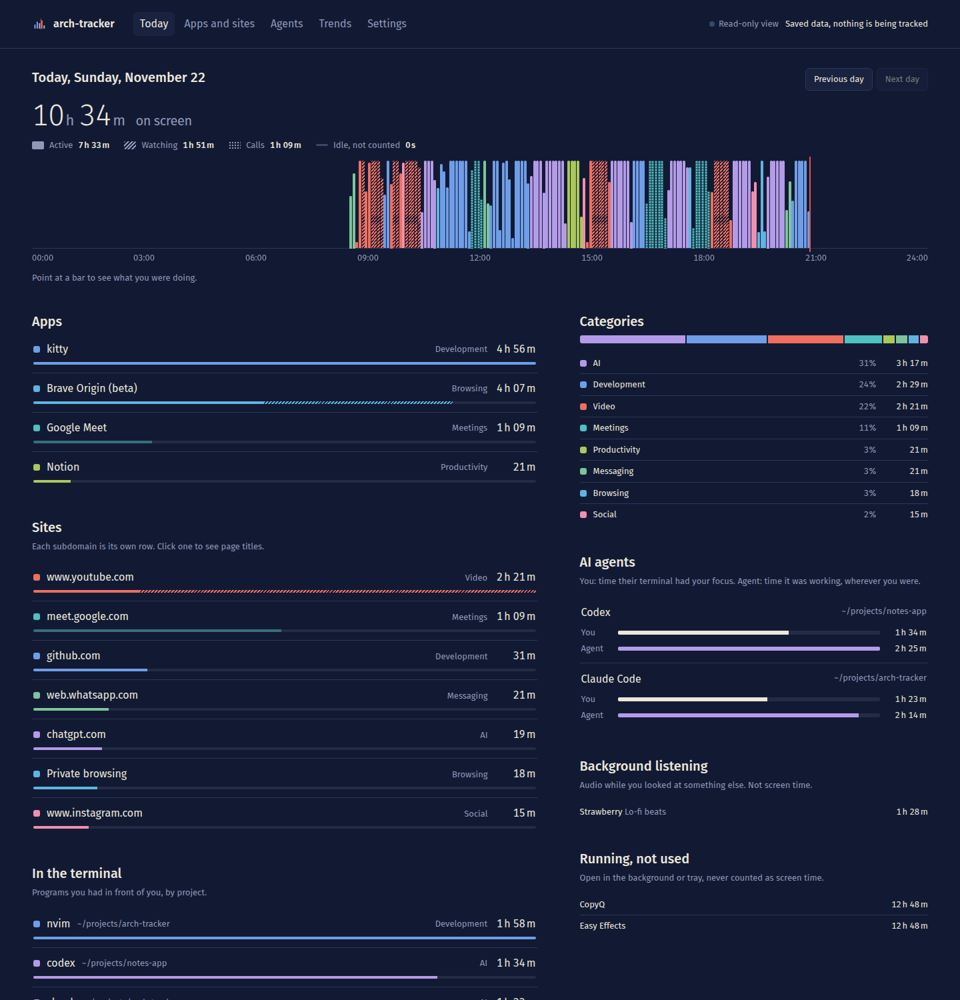
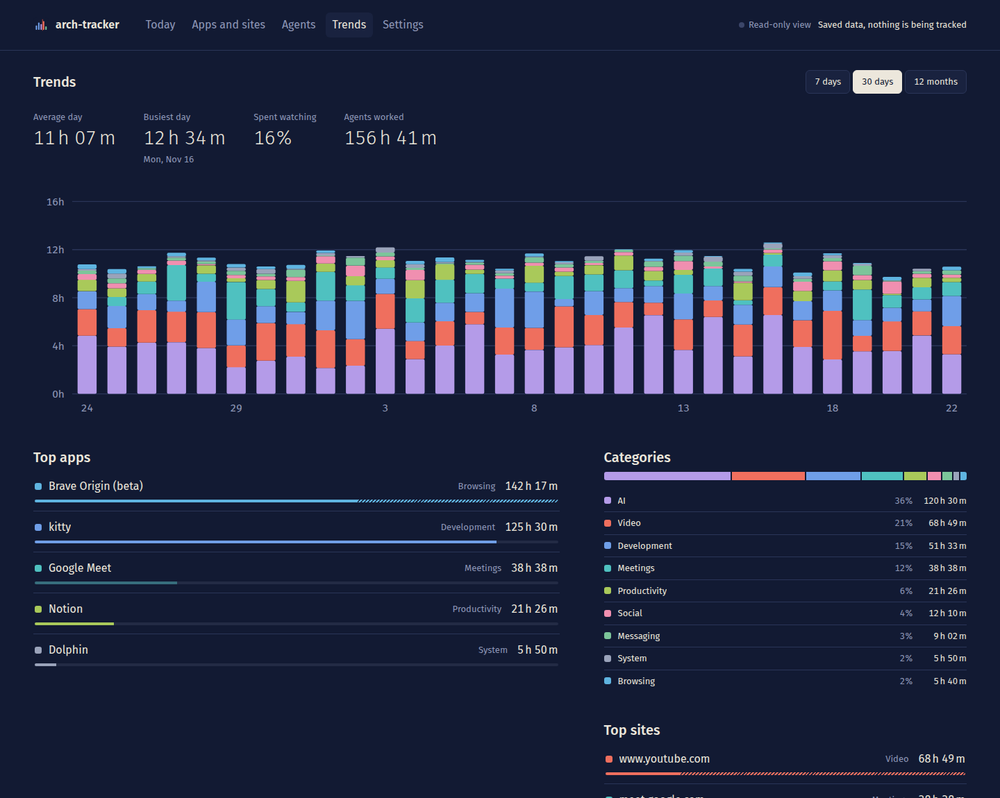

# arch-tracker

[](https://github.com/abhimangs/arch-tracker/actions/workflows/ci.yml)
[](https://github.com/abhimangs/arch-tracker/releases)
[](LICENSE)

Screen time for KDE Plasma on Wayland. arch-tracker records which app has your focus, which sites
you use (with subdomains kept apart), what runs in your terminal, and how long your AI coding agents
work, then shows it all in a local dashboard. It runs as a small user service (about 12 MB of memory)
and nothing leaves your computer.



## What it records

| Source | What you get | How |
| --- | --- | --- |
| Windows | The focused app and window title, to the second; windows that sit visible beside it | A KWin script, loaded at runtime (your `kwinrc` is not touched) |
| Browser | The active tab's host and page title; each subdomain separate | A small Brave/Chromium extension over native messaging. Plasma Browser Integration and Chromium's session file are fallbacks |
| Incognito | Time only, counted as "Private browsing" | Hosts and titles from private windows are never stored |
| Terminals | The program in front of you and its project (git root) | kitty remote control (exact tab); `/proc` for ghostty and others; tmux panes |
| AI agents | Per tool and project: time you watched it, and time it was working | Claude Code, Codex, opencode, Antigravity, Cursor Agent, Hermes, Gemini CLI, Aider and more, matched by name |
| Idle | Gaps with no keyboard or mouse input | Wayland `ext-idle-notify` v2 |
| Watching and calls | Video playing in a visible window; microphone open | MPRIS players, the browser extension, and the ALSA capture state |
| Background | Music in a hidden tab; apps open in the tray but unused | Shown separately, never added to screen time |

## How screen time is decided

arch-tracker stores raw facts (focus, no-input gaps, media, microphone, lock, suspend) and decides
what counts when you look at the data:

- **Active**: you are using the computer, or paused for less than the idle threshold (3 minutes).
- **Watching**: no input, but video or audio plays in a window you can see. No time limit.
- **Call**: the microphone is open. Up to 5 minutes without input still counts.
- **Idle**: everything else is removed, back to your last input.

Change a threshold in Settings and every past day is re-classified.

<table>
<tr>
<td></td>
<td></td>
</tr>
<tr>
<td colspan="2"></td>
</tr>
</table>

## Install

Requires Arch Linux (or a derivative) with KDE Plasma 6 on Wayland.

**From a release:** download `arch-tracker-<version>-1-x86_64.pkg.tar.zst` from
[Releases](https://github.com/abhimangs/arch-tracker/releases) and install it:

```sh
sudo pacman -U arch-tracker-*-x86_64.pkg.tar.zst
```

**From source:**

```sh
git clone https://github.com/abhimangs/arch-tracker.git
cd arch-tracker/packaging
makepkg -si
```

Then, as your own user:

```sh
systemctl --user enable --now arch-tracker
arch-tracker setup     # registers the browser bridge and prints the extension steps
arch-tracker doctor    # checks every source and says how to fix problems
```

Open the dashboard at http://127.0.0.1:7600/.

### Browser extension

For exact tabs, load the extension once:

1. Open `brave://extensions` (or `chrome://extensions`) and switch on **Developer mode**.
2. Click **Load unpacked** and choose `/usr/share/arch-tracker/extension`.
3. The extension ID must be `ofgofljkhfmjkgklekeiajnkplaldokg`.

Without it, tabs are matched by window title through Plasma Browser Integration, which can mix up
two tabs with the same title.

### kitty

kitty is read exactly when remote control is on. Add to `kitty.conf`:

```
allow_remote_control socket-only
listen_on unix:/tmp/kitty.sock
```

## Commands

| Command | What it does |
| --- | --- |
| `arch-tracker status` | What is tracked right now and which sources work |
| `arch-tracker pause 1h` / `arch-tracker resume` | Pause recording; no duration pauses until you resume |
| `arch-tracker doctor` | Check every source, with fixes |
| `arch-tracker export --from 2026-11-01 --to 2026-11-22 --format csv` | Every recorded interval, as CSV or JSON |
| `arch-tracker serve --db copy.db` | A read-only dashboard for any database, without tracking |
| `arch-tracker setup` | Unpack the extension and register the native-messaging host |

## Configuration

Settings live in `~/.config/arch-tracker/config.toml` and on the dashboard's Settings page. Both
are picked up live. You can change:

- idle and call thresholds, and what counts as watching
- categories (sites, apps and programs; the most specific site wins)
- AI agent names to recognise, and when an agent counts as working
- apps and sites never to record
- the dashboard port, theme (system, dark, light) and your own CSS

## Privacy

- Data lives in `~/.local/share/arch-tracker/tracker.db` and is never sent anywhere.
- The dashboard answers only on `127.0.0.1`, refuses other host names, and needs a per-run token
  for every change.
- Browsers send host and title only: no paths, no query strings, nothing from incognito.
- Terminals give program name and project only: never arguments or environment variables.
- `arch-tracker pause` stops recording; the exclude list hides chosen apps and sites.

See [SECURITY.md](SECURITY.md) for the threat model and how to report a problem.

## How it works

One Rust binary runs as a systemd user service. Event sources (KWin, Wayland idle, logind, MPRIS,
the browser bridge, terminals) feed a single tracker that opens and closes intervals in SQLite,
writing in batches every 30 seconds. The dashboard is served by the same process from embedded
files. Each source sits in its own module, so other desktops (GNOME, Hyprland, Sway) can be added
as new window sources; the idle source already works on most wlroots compositors.

## Contributing

See [CONTRIBUTING.md](CONTRIBUTING.md). Changes are listed in [CHANGELOG.md](CHANGELOG.md).

## License

[MIT](LICENSE)
