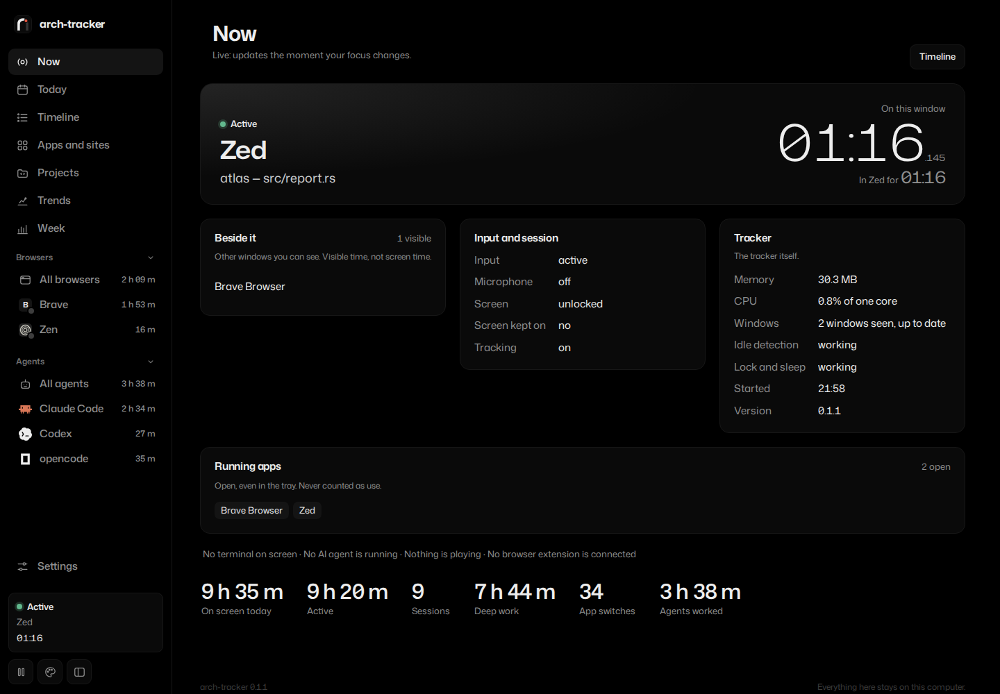
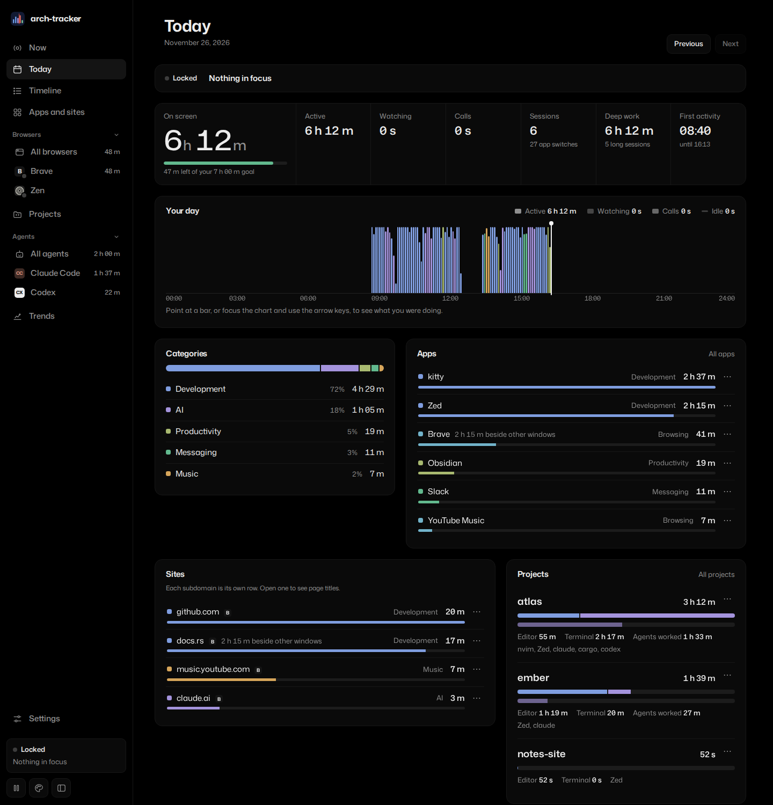
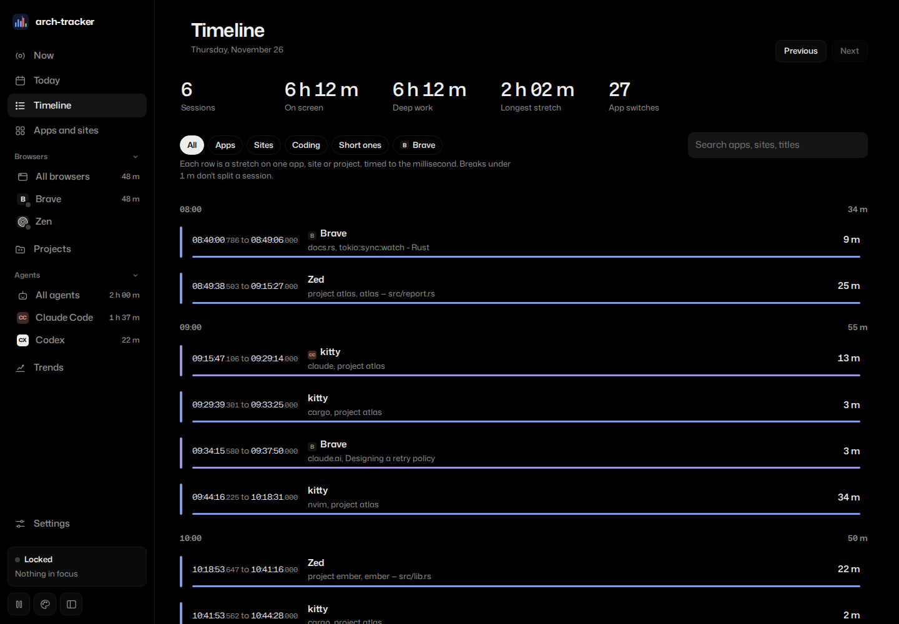
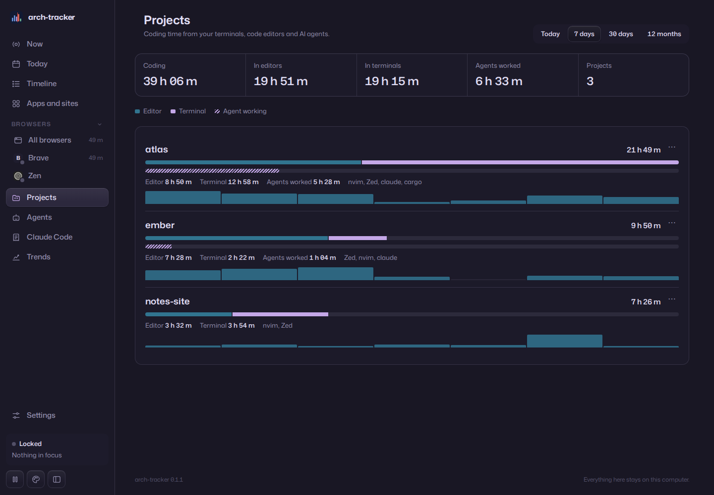
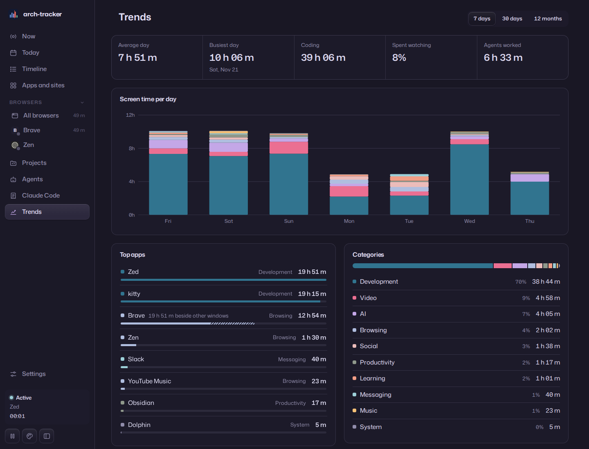
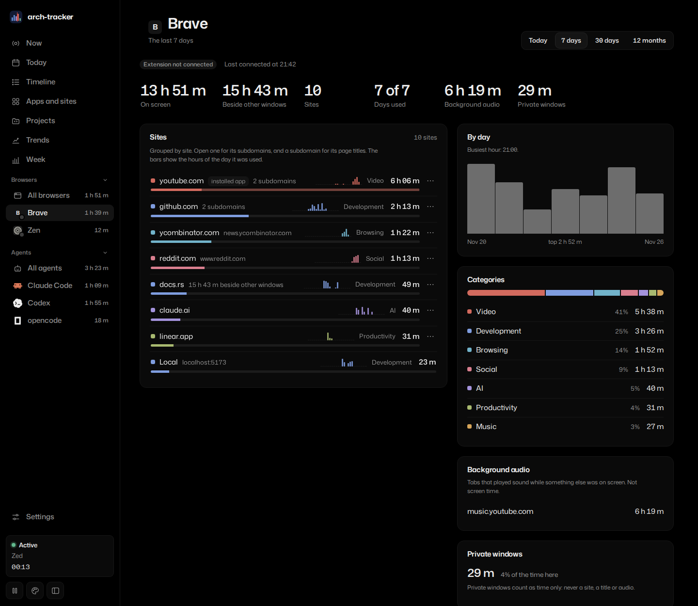
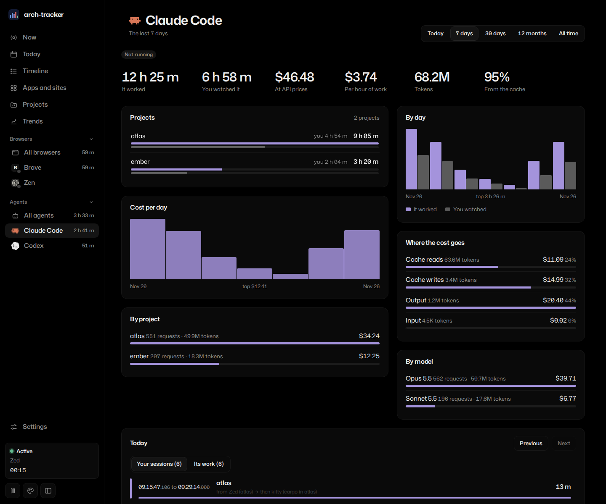
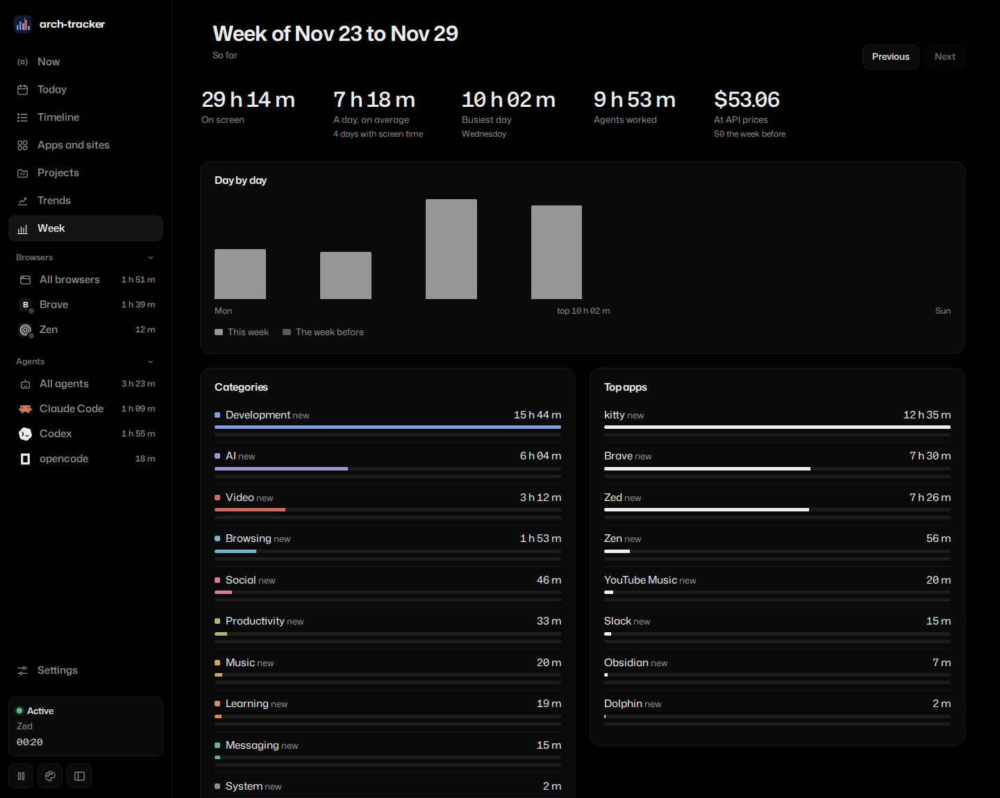
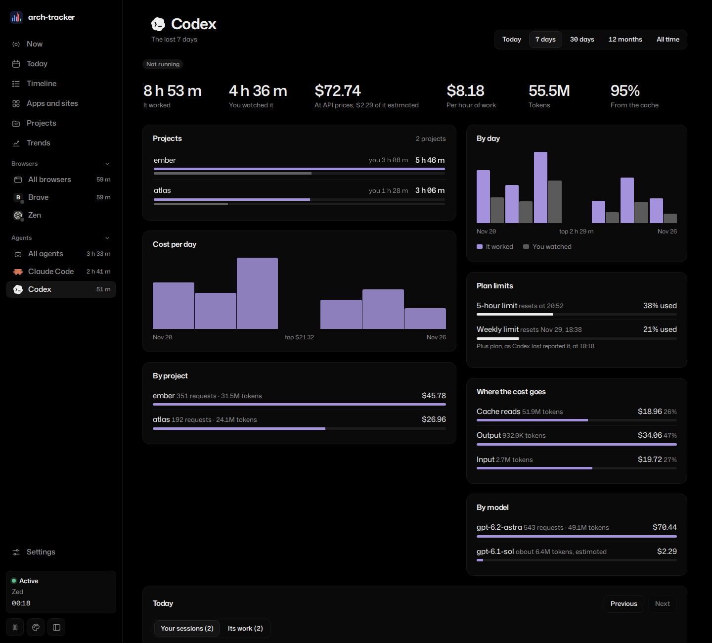

# arch-tracker

[](https://github.com/abhimangs/arch-tracker/actions/workflows/ci.yml)
[](https://github.com/abhimangs/arch-tracker/releases)
[](LICENSE)

Screen time for KDE Plasma, GNOME, Hyprland and Sway on Wayland. arch-tracker records which app has your focus, which sites
you use (with subdomains kept apart), what runs in your terminal, and how long your AI coding agents
work, then shows it all in a local dashboard with a tray icon. It runs as a small user service (about
12 MB of memory, close to 0 % CPU) and nothing leaves your computer.



## What it records

| Source | What you get | How |
| --- | --- | --- |
| Windows | The focused app and window title, to the second; windows that sit visible beside it | On Plasma a KWin script, loaded at runtime (your `kwinrc` is not touched); on GNOME a small Shell extension; on Hyprland and Sway their IPC sockets |
| Browser | The active tab's host and page title; each subdomain separate | A small extension for Chromium-based browsers (Brave, Chrome, Chromium, Helium, Vivaldi, Edge, Opera…) and Firefox-based ones (Firefox, Zen, LibreWolf, Floorp, Waterfox), over native messaging. Plasma Browser Integration and Chromium's session file are fallbacks |
| Incognito | Time only, counted as "Private browsing" | Hosts and titles from private windows are never stored |
| Terminals | The program in front of you and its project (git root) | kitty remote control (exact tab); `/proc` for ghostty and others; tmux panes |
| AI agents | Per tool and project: time you watched it, and time it was working | Claude Code, Codex, opencode, Antigravity, Cursor Agent, Hermes, Gemini CLI, Aider and more, matched by name |
| Claude Code cost | What its requests would cost at Anthropic's API prices, per day, model and project, on its own page | Token counts from Claude Code's own transcripts and statistics, read-only: prompts and replies are never kept |
| Hermes cost | The same for Hermes Agent, per model | Token counts per session and model from Hermes's own database, read-only |
| opencode cost | The same for opencode, per response, model and project; free and stealth models show as free | Token counts per response from opencode's own database, read-only |
| Codex cost | The same at OpenAI's list prices, plus its plan's limits | Token counts from Codex's session logs, and for conversations whose logs Codex has removed, the token totals in its own database (an estimate), read-only |
| Idle | Gaps with no keyboard or mouse input | Wayland `ext-idle-notify` v2 |
| Watching and calls | Video playing in a visible window; microphone open | MPRIS players, the browser extension, and the ALSA capture state |
| Background | Music in a hidden tab; apps open in the tray but unused | Shown separately, never added to screen time |

## The dashboard

- **Now**: what has your focus this moment, with a millisecond timer, the windows beside it,
  terminals, AI agents and their CPU, media, input and lock state, and connected browsers. It
  updates the instant focus changes.
- **Today**: the day as five-minute bars, screen time against your goal, categories against their
  limits, apps, sites, coding projects, agents and focus stats (longest stretch, deep work, switches).
- **Timeline**: every session (a stretch on one app, site or project) with its exact start and end,
  filterable and searchable.
- **Projects**: coding time per project from terminals, code editors and agents.
- **Browsers**: a sidebar group with every browser the extension has connected from (Brave, Zen,
  Helium…), each with its own icon, today's time and a dot while its extension is connected, and
  All browsers on top once there are two. A browser's page groups its sites by domain, then subdomain, then page title,
  with the hours of the day each was used; adds background audio and private-window time; and lists
  each visit of a day with its exact start and end and what came right before and after it.
- **Agents**: a sidebar group for Claude Code and Codex (and Hermes once it is installed), with
  All agents on top. An agent's page shows the time it worked beside the time you watched it, per
  project and per hour or day, your sessions in its terminal with what came before and after, and
  its stretches of work. Claude Code and Codex add what their requests would cost at API prices
  (by day, kind of token, model and project), and Codex its plan's 5-hour and weekly limits.
- **Apps and sites** and **Trends** over a day, a week, a month or a year.
- **Week**: a week against the one before, day by day, with categories, apps, sites, agents and
  their cost; a notification on the first morning of each week sums up the last one.
- **Alerts**: desktop notifications (with a sound) for category limits, your daily goal, breaks,
  Codex's plan limits at the share you choose, and the weekly summary; and when an AI agent you
  aren't looking at finishes or waits for your answer, with a click that takes you back to its
  terminal tab.

## How screen time is decided

arch-tracker stores raw facts (focus, no-input gaps, media, microphone, lock, suspend) and decides
what counts when you look at the data:

- **Active**: you are using the computer, or paused for less than the idle threshold (3 minutes).
- **Watching**: no input, but video or audio plays in a window you can see. No time limit.
- **Call**: the microphone is open. Up to 5 minutes without input still counts.
- **Idle**: everything else is removed, back to your last input.

Change a threshold in Settings and every past day is re-classified.

<table>
<tr>
<td colspan="2"></td>
</tr>
<tr>
<td></td>
<td></td>
</tr>
<tr>
<td></td>
<td></td>
</tr>
<tr>
<td colspan="2"></td>
</tr>
<tr>
<td colspan="2"></td>
</tr>
<tr>
<td colspan="2"></td>
</tr>
<tr>
<td colspan="2"></td>
</tr>
</table>

Screenshots use made-up data (`arch-tracker demo`) in the OLED theme; `node scripts/screenshots.mjs` regenerates them.

## Install

Requires Arch Linux (or a derivative) with KDE Plasma 6, GNOME 45 to 51, Hyprland or Sway on
Wayland (see [GNOME](#gnome) and [Hyprland and Sway](#hyprland-and-sway) for what differs there).

**From a release:** download `arch-tracker-<version>-1-x86_64.pkg.tar.zst` from
[Releases](https://github.com/abhimangs/arch-tracker/releases) and install it:

```sh
sudo pacman -U arch-tracker-*-x86_64.pkg.tar.zst
```

**From source:**

```sh
git clone https://github.com/abhimangs/arch-tracker.git
cd arch-tracker/packaging
makepkg -si
```

AUR packages (`arch-tracker` and `arch-tracker-bin`) are ready in [packaging/aur](packaging/aur)
for when they are published there.

Then, as your own user:

```sh
systemctl --user enable --now arch-tracker
arch-tracker setup     # registers the browser bridge and prints the extension steps
arch-tracker doctor    # checks every source and says how to fix problems
```

Open the dashboard from the tray icon, or run `arch-tracker open`. It lives at
http://arch-tracker.localhost:7600/ and is locked to you: the tray icon and `arch-tracker open` sign
your browser in once, after which bookmarks work too. Other programs on the computer can't read it.

### Browser extension

For exact tabs, add the extension once to each browser you use. `arch-tracker setup` registers the
bridge in every installed browser and prints these steps.

**Chromium-based** (Brave, Chrome, Chromium, Helium, Vivaldi, Edge, Opera, Thorium):

1. Open `brave://extensions` or `chrome://extensions` and switch on **Developer mode**.
2. Click **Load unpacked** and choose `/usr/share/arch-tracker/extension`.
3. The extension ID must be `ofgofljkhfmjkgklekeiajnkplaldokg`.

**Firefox-based** (Firefox, Zen, LibreWolf, Floorp, Waterfox): Firefox and Zen keep only add-ons
signed by Mozilla. Sign your own copy once, privately (nothing is published):

1. Create an API key at <https://addons.mozilla.org/developers/addon/api/key/> and save it in
   `~/.config/arch-tracker/amo.env` (then `chmod 600` it):
   ```
   AMO_JWT_ISSUER=user:12345:67
   AMO_JWT_SECRET=…
   ```
2. Run `scripts/sign-firefox.sh` from a checkout, and open the `.xpi` it prints in your browser.

LibreWolf, Floorp, Waterfox and Firefox Developer Edition also accept the unsigned add-on after
setting `xpinstall.signatures.required` to `false` in `about:config`. For a quick test in any
of them, `about:debugging` → **Load Temporary Add-on** → `/usr/share/arch-tracker/extension-firefox/manifest.json`
works until the browser restarts.

Flatpak and Snap browsers can't start the bridge from their sandbox; their windows are still tracked
through the fallbacks. Without the extension, tabs are matched by window title through Plasma
Browser Integration, which can mix up two tabs with the same title.

### GNOME

`arch-tracker setup` switches on the arch-tracker Shell extension (the package installs it to
`/usr/share/gnome-shell/extensions`). GNOME on Wayland loads new extensions at login, so log out
and back in once. The extension only tells the daemon on this computer which windows there are and
which has focus, the same as the KWin script does on Plasma. Idle time comes from GNOME's own idle
monitor. The tray icon needs the AppIndicator extension (`gnome-shell-extension-appindicator`),
and Plasma Browser Integration is Plasma's only.

### Hyprland and Sway

The tracker finds the compositor on its own. Its service starts with `graphical-session.target`,
which uwsm (Hyprland) and sway-systemd (Sway) start for you. Without them, start it from the
compositor's config, which also hands it the session's variables:

```
# hyprland.conf
exec-once = systemctl --user import-environment WAYLAND_DISPLAY XDG_CURRENT_DESKTOP HYPRLAND_INSTANCE_SIGNATURE && systemctl --user start arch-tracker
# sway config
exec systemctl --user import-environment WAYLAND_DISPLAY XDG_CURRENT_DESKTOP SWAYSOCK && systemctl --user start arch-tracker
```

Idle time, media, terminals, agents and the browser extension work as on Plasma. The tray icon
needs a StatusNotifierItem tray (Waybar's `tray` module), notifications need a notification daemon
(mako, dunst, SwayNC), and Plasma Browser Integration is Plasma's only. hyprlock and swaylock don't
tell logind the screen is locked, so a locked screen counts as idle rather than locked.

### kitty

kitty is read exactly when remote control is on. Add to `kitty.conf`:

```
allow_remote_control socket-only
listen_on unix:/tmp/kitty.sock
```

## Commands

| Command | What it does |
| --- | --- |
| `arch-tracker open [page]` | Open the dashboard in your browser, signed in (`today`, `apps`, `agents`, `trends`, `settings`) |
| `arch-tracker status` | What is tracked right now and which sources work |
| `arch-tracker today [--date yesterday] [--json]` | The day in the terminal: screen time and goal, categories and limits, top apps and sites, projects, and agents with their cost |
| `arch-tracker pause 1h` / `arch-tracker resume` | Pause recording; no duration pauses until you resume |
| `arch-tracker doctor` | Check every source, with fixes |
| `arch-tracker export --from 2026-11-01 --to 2026-11-22 --format csv` | Every recorded interval, as CSV or JSON |
| `arch-tracker serve --db copy.db` | A read-only dashboard for any database, without tracking |
| `arch-tracker setup` | Unpack the extensions and register the bridge in every installed browser |

## Configuration

Settings live in `~/.config/arch-tracker/config.toml` and on the dashboard's Settings page. Both
are picked up live. You can change:

- idle and call thresholds, and what counts as watching
- categories (sites, apps and programs; the most specific site wins)
- AI agent names to recognise, and when an agent counts as working; whether to show Claude Code's
  cost, and your own prices (`[agents.prices]`) for models the built-in table lacks
- apps and sites never to record
- categories, apps and sites never to record, project renames and "not a project" can also be set
  from a row's ⋯ menu on Today, Apps and sites, and Projects, without opening Settings
- the dashboard port (applied at once, whichever way you change it), your own CSS and the tray icon
- the page it opens on, a 12- or 24-hour clock, milliseconds on live timers, density and motion
- a daily screen-time goal, per-category daily limits, what counts as a session and as deep work
- desktop notifications: a heads-up before and a notice at each category limit and the daily goal,
  and a reminder to take a break after a long stretch on screen (it waits until a call or a video
  ends), and agents that finish or wait for you. One switch turns all of them off, and Settings
  can send a test notice
- which apps are code editors, project renames, and which folders are projects: parent folders
  (every folder inside one is a project) and single project folders, git repository or not, picked
  from a folder browser that also suggests the folders you worked in; and folders that aren't
  projects
- how many days of history to keep, and recomputing past days after changes the cache can't notice
- the look: OLED (true black, the default, with a Paper light mode), Catppuccin (Mocha, Macchiato,
  Frappé, Latte), Rosé Pine (Main, Moon, Dawn) or the original Aizome, any of their accents, following the system or fixed dark or light. Category
  colours follow the theme unless you switch that off. The palette button in the header switches
  it instantly.

## Privacy

- Data lives in `~/.local/share/arch-tracker/tracker.db` and is never sent anywhere.
- The dashboard answers only on `127.0.0.1` as `arch-tracker.localhost`, refuses other host
  names, and is locked: without the sign-in cookie it shows nothing, so other programs and other
  users can't read your history. Every change also needs a per-run token.
- Browsers send host and title only: no paths, no query strings (untitled pages that show their
  URL are reduced to the host), and from private windows only that time was spent.
- Terminals give program name and project only: never arguments, window titles (which shells set
  to the running command) or environment variables.
- `arch-tracker pause` stops recording; the exclude list hides chosen apps and sites.
- Claude Code's transcripts (`~/.claude/projects`) and statistics (`~/.claude/stats-cache.json`)
  are only read: opened read-only, never written, renamed or locked, without following links and
  without even updating their access time. From each request only the model, its time, its token
  counts and its folder are kept; prompts, replies and file contents are never stored. Claude Code
  deletes transcripts after 30 days by default (`cleanupPeriodDays`); arch-tracker keeps the
  counts. Switch it off under Settings → AI agents.

See [SECURITY.md](SECURITY.md) for the threat model and how to report a problem.

## Resource use

Measured on a running daemon: about 11.5 MB resident, of which about 2 MB is its own memory (the
rest is the shared executable), and about 0.1 % of one core. The dashboard server idles inside the
same process at no measurable cost, and the tray icon uses the existing D-Bus connection. The
systemd unit caps memory at 64 MB.

## How it works

One Rust binary runs as a systemd user service. Event sources (the window manager, Wayland idle,
logind, MPRIS, the browser bridge, terminals) feed a single tracker that opens and closes intervals
in SQLite, writing in batches every 30 seconds. The dashboard is served by the same process from
embedded files. Windows come from whichever desktop runs: a KWin script on Plasma, a Shell extension
on GNOME, or Hyprland's and Sway's IPC sockets; each becomes the same snapshot of windows, so
everything after it is shared.

## Contributing

See [CONTRIBUTING.md](CONTRIBUTING.md). Changes are listed in [CHANGELOG.md](CHANGELOG.md).

## License

[MIT](LICENSE)
